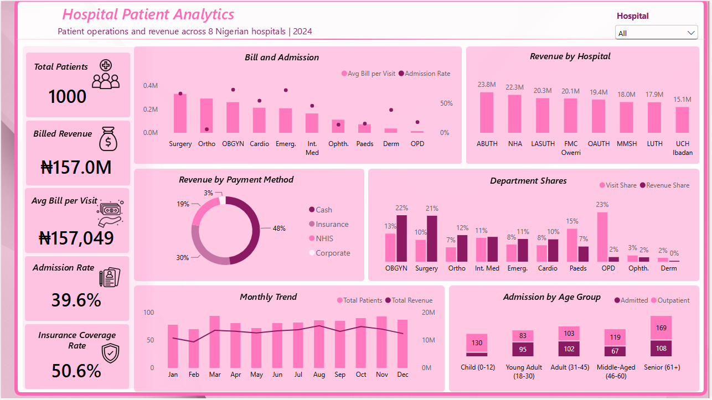
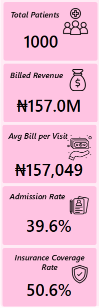
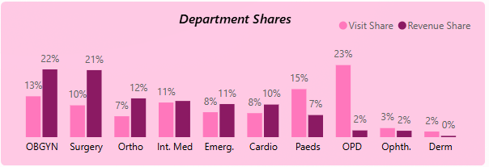
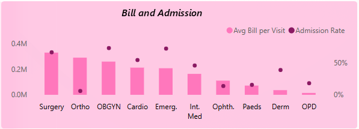
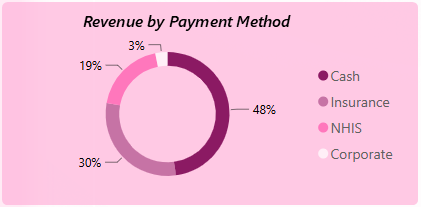
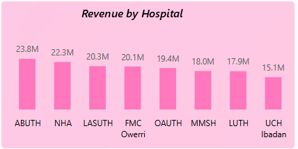
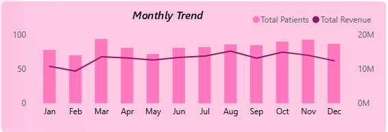
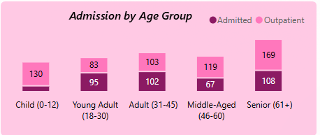

# Hospital Patient Analytics: Operations and Revenue Across 8 Nigerian Hospitals

> How 1,000 patient visits across 8 hospitals showed where revenue is concentrated, who pays for it, and which billing records needed a second look.



---

## Project Type

- [x] Exploratory Analysis
- [ ] SQL Analysis
- [x] Dashboard / Visualization
- [x] Data Cleaning
- [ ] Predictive Modelling
- [x] End-to-End Project

---

## Table of Contents

1. [Executive Summary](#1-executive-summary)
2. [Key Takeaways](#2-key-takeaways)
3. [Background & Problem](#3-background--problem)
4. [Stakeholders](#4-stakeholders)
5. [Objectives & Success Metrics](#5-objectives--success-metrics)
6. [Project Scope](#6-project-scope)
7. [Tools Used](#7-tools-used)
8. [Repository Structure](#8-repository-structure)
9. [Dataset Overview & Data Dictionary](#9-dataset-overview--data-dictionary)
10. [Data Cleaning & Quality](#10-data-cleaning--quality)
11. [Methodology & Exploratory Analysis](#11-methodology--exploratory-analysis)
12. [Analytical Decisions](#12-analytical-decisions)
13. [Validation](#13-validation)
14. [Key Findings](#14-key-findings)
15. [Dashboard / Report Walkthrough](#15-dashboard--report-walkthrough)
16. [Dashboard Design Decisions](#16-dashboard-design-decisions)
17. [Recommendations](#17-recommendations)
18. [Data Privacy & Ethical Considerations](#18-data-privacy--ethical-considerations)
19. [Clinical / Public Health Context](#19-clinical--public-health-context)
20. [Assumptions & Limitations](#20-assumptions--limitations)
21. [Conclusion](#21-conclusion)
22. [AI Usage Disclosure](#22-ai-usage-disclosure)
23. [How to Reproduce This Project](#23-how-to-reproduce-this-project)
24. [Author](#24-author)

---

## 1. Executive Summary

This project analyzed 1,000 patient visits across 8 Nigerian teaching and specialist hospitals in 2024. The goal was to see where revenue comes from, how patients pay, and which departments carry the most cost. Data cleaning was done in Excel. Power BI handled the analysis and the visualization. The analysis found that Obstetrics & Gynaecology and Surgery produced 43% of revenue from 23% of visits. It also found that cash payers made up 46% of patients and 48% of revenue. A billing check flagged 67 visits where the bill did not match the admission status. Together, these findings show where a hospital's finance and operations teams should look first.

---

## 2. Key Takeaways

1. Two departments, Obstetrics & Gynaecology and Surgery, generated 43% of revenue from 23% of visits.
2. Cash was the largest payment source, at 46% of patients and 48% of revenue.
3. 67 visits (6.7%) carried billing amounts that did not fit their admission status and need an audit.

---

## 3. Background & Problem

Hospital managers in Nigeria often work with patient records spread across departments and payment types. That makes it hard to answer simple questions. Which departments carry the revenue? How much of it depends on patients paying out of pocket? Are the billing records even reliable?

This project set out to answer one question: across these 8 hospitals, where does revenue concentrate, who pays for it, and what in the billing data needs checking before anyone relies on it?

---

## 4. Stakeholders

| Stakeholder | Why This Work Matters to Them |
|---|---|
| Hospital Finance Manager | Uses the payment split to plan billing and insurance enrolment |
| Chief Medical Director | Uses department revenue and admission patterns to plan capacity |
| Health Information Manager | Uses the billing flags to start a records audit |

---

## 5. Objectives & Success Metrics

- **Objective:** Show where revenue concentrates across departments and hospitals, and how patients pay.
- **Objective:** Find billing records that need review before they feed any decision.
- **Target:** Review and resolve all 67 flagged billing records, so none feed a forecast unchecked.
- **Target:** Use 50.6% insurance and NHIS coverage as the baseline, and track whether it rises in the next review.

---

## 6. Project Scope

| In Scope | Out of Scope |
|---|---|
| 1,000 patient visits, 8 hospitals, 10 departments, 71 diagnoses | Clinical outcomes such as mortality or readmission, not captured in this data |
| Visits from 31 Dec 2023 to 27 Dec 2024 (999 of 1,000 fall in 2024) | Individual doctor performance, excluded on purpose, see Privacy section |
| Billing, payment method, admission status, age, gender, diagnosis | Cost of care to the hospital, only billed amounts are available |

---

## 7. Tools Used

| Stage | Tool |
|---|---|
| Data source | Synthetic hospital patient-level dataset (Excel workbook) |
| Data cleaning | Excel |
| Data transformation | Excel (helper columns), DAX calculated column in Power BI |
| Analysis | DAX measures in Power BI |
| Visualization | Power BI |

---

## 8. Repository Structure

```
hospital-patient-analytics/
│
├── dashboard/
│   └── Nigerian_Hospital_Analytics.pbix
│
├── data/
│   └── hospital_patients_cleaned.csv
│
├── docs/
│   └── dax_measures.txt
│
├── visuals/
│   ├── dashboard_full.png
│   ├── kpi_snapshot.png
│   ├── department_shares.png
│   ├── bill_and_admission.png
│   ├── revenue_by_payment_method.png
│   ├── revenue_by_hospital.png
│   ├── monthly_trend.png
│   └── admission_by_age_group.png
│
└── README.md
```

---

## 9. Dataset Overview & Data Dictionary

The dataset holds 1,000 patient visits, one row per visit, across eight hospitals and ten departments. Each row records who was seen, where, for what, what they were billed, how they paid, and whether they were admitted.

| Field | Type | Description | Example |
|---|---|---|---|
| `patient_id` | integer | Unique visit record ID | `256176` |
| `patient_age` | integer | Age in years (1 to 87) | `69` |
| `hospital_id` | integer | Code for the hospital | `11678` |
| `patient_diagnosis` | string | Primary diagnosis (71 distinct values) | `Hypertension` |
| `hospital_department` | string | Department that treated the patient | `Cardiology` |
| `billing_amount` | integer (₦) | Amount billed for the visit | `277521` |
| `payment_method` | string | Cash, Insurance, NHIS, or Corporate | `Insurance` |
| `admission_status` | string | Admitted or Outpatient | `Outpatient` |
| `visit_date` | date | Date of the visit | `2024-07-23` |



**What this shows:** The five headline numbers the dashboard opens with: total patients, total revenue, average bill, admission rate, and insurance coverage.
**Why it matters:** Every chart that follows breaks one of these five numbers apart, so it helps to know them first.

**Source:** Synthetic patient-level dataset built for this project

---

## 10. Data Cleaning & Quality

**Question:** Was the dataset ready to analyze?

**What I found:** 3 problems.
- Hospital names were typed 14 different ways for 8 hospitals. Lagos State University Teaching Hospital alone appeared with trailing dots and brackets in four spellings.
- Two records had the hospital name `Hospital.` with nothing else.
- 67 visits had a billing amount that did not fit the admission status. 34 admitted patients were billed between ₦5,394 and ₦19,916. 33 outpatients were billed between ₦401,005 and ₦599,969.

**What I changed:**
- Standardized the hospital names into a clean column, which brought 14 spellings down to 8 hospitals.
- Matched the two `Hospital.` records by `hospital_id` instead of guessing from the name. They belong to National Hospital Abuja and Federal Medical Centre Owerri.
- Flagged the 67 billing mismatches with a label instead of deleting them. They stay in every total.
- Added helper columns for age group, billing band, month, and insurance coverage.

**Why it mattered:** The hospital code is the only field that cannot be mistyped into another hospital, so it is the safer key. Flagging instead of deleting keeps total revenue equal to the raw data (₦157,048,846) and leaves the audit decision to the people who own the billing records.

---

## 11. Methodology & Exploratory Analysis

**Question:** How did I approach finding the answer?

I compared revenue, visit counts, average bill, and admission rate across departments, hospitals, payment methods, months, and age groups. I used Excel PivotTables for a first pass and DAX measures in Power BI for the final dashboard. Both are plain descriptive comparisons, not a model. The goal was to locate where things concentrate, not to forecast.

Early on, one pattern stood out. Visit share and revenue share were very different by department. General Outpatient had 23% of visits and 2% of revenue. That gap shaped the rest of the analysis.

---

## 12. Analytical Decisions

Used average bill per visit next to total revenue for departments, because total revenue alone hides whether a department earns a lot per visit or simply sees many patients. Trade-off: two measures take more space on the dashboard, but they answer different questions.

Counted NHIS and private insurance together as "covered", because both mean a third party pays. Trade-off: this hides the difference between the two schemes, so the payment chart keeps them separate.

Kept flagged billing records in the totals, because removing them without a billing audit would be a guess. Trade-off: totals include 67 visits that may be wrong.

---

## 13. Validation

**Question:** Could these numbers be trusted?

Recounted total patients, revenue, and average bill from the raw sheet and compared them with the dashboard cards → matched exactly (1,000 visits, ₦157,048,846, ₦157,049).

Rebuilt the hospital totals using `hospital_id` instead of the cleaned name column → found that the two `Hospital.` records had been assigned to Lagos University Teaching Hospital in the first cleaning pass. Reassigning them moved ₦569,753 to National Hospital Abuja and ₦20,034 to Federal Medical Centre Owerri. Lagos University Teaching Hospital falls from ₦18.52M to ₦17.93M and drops below Murtala Mohammed Specialist Hospital in the revenue ranking.

Checked the monthly figures against visit dates → found one visit dated 31 Dec 2023 sitting in the December count.

Rebuilt the dashboard in Power BI from the corrected file, then compared the KPI cards, hospital labels, payment shares, department shares, and age group counts with totals recalculated outside Power BI → all matched. The Monthly Trend chart is filtered to 2024 visits, so it shows 999 of the 1,000 visits and leaves out the visit dated 31 Dec 2023.

The cleaned file in `data/` carries the corrected hospital names in `hospital_name`, and a `period_flag` column that marks the one 2023 visit.

---

## 14. Key Findings


| KPI | Result | What It Tells Us |
|---|---:|---|
| Total Patients | 1,000 | Total patients for a full year of visits across 8 hospitals |
| Billed Revenue | ₦157,048,846 | The amount billed, not the amount collected |
| Average Bill per Visit | ₦157,049 | Hides a huge spread, from ₦14,640 in outpatient to ₦330,777 in surgery |
| Admission Rate | 40% | 4 in 10 visits end in admission |
| Insurance Coverage Rate | 51% | Half of visits are covered by insurance or NHIS, the other half are not |

**What do these numbers tell us?** The averages look calm. The spread underneath them is not. A few departments earn most of the revenue, and nearly half the patients pay cash. A hospital that planned around the average bill would plan wrongly for almost every department.

**What should we look at next?** The dashboard walkthrough shows which departments drive revenue, how patients pay in each, and where the data needs a second look.

---

## 15. Dashboard / Report Walkthrough

### Page 1: Hospital Patient Analytics

**What does this page help us understand?** Where visits and revenue concentrate, and how patients pay for care.


Start with the five KPI cards on the left. They set the baseline. The Hospital dropdown at the top right filters the charts to one hospital. Then read the charts from top to bottom.

#### Department Shares



**Question this visual answers:** Which departments earn a bigger share of revenue than their share of visits?
**What the data shows:** Obstetrics & Gynaecology brings 13% of visits and 22% of revenue. Surgery brings 10% of visits and 21% of revenue. Together they are 23% of visits and 43% of revenue. General Outpatient is the opposite, with 23% of visits and 2% of revenue.
**What it means:** Revenue follows what a visit costs, not how many visits there are.
**Why it matters:** A hospital that plans by patient count would rank its departments wrongly. Two departments carry the revenue.

#### Bill and Admission



**Question this visual answers:** Which departments earn the most per visit, and do they admit patients more often?
**What the data shows:** Surgery has the highest average bill at ₦330,777. Orthopaedics follows at ₦291,293 and Obstetrics & Gynaecology at ₦260,377. General Outpatient is lowest at ₦14,640. The dots show the admission rate, which runs from 6% in Orthopaedics to 73% in Obstetrics & Gynaecology.
**What it means:** Admission does not explain the bill on its own. Orthopaedics bills almost as much as Surgery with only 6% of patients admitted.
**Why it matters:** A high bill with a low admission rate is worth a billing review. It could be a real procedure cost or a coding problem.

#### Revenue by Payment Method



**Question this visual answers:** Where does the hospital's revenue come from, and how exposed is it to out-of-pocket payment?
**What the data shows:** Cash brings in 48% of revenue, insurance 30%, NHIS 19%, and corporate 3%. By patients, cash is 46%, insurance 31%, NHIS 20%, and corporate 4%.
**What it means:** Nearly half of billed revenue depends on patients paying from their own pockets.
**Why it matters:** Cash-heavy revenue is the hardest to collect and the first to fall when household budgets tighten. Surgery is the most exposed, at 55% cash.

#### Revenue by Hospital



**Question this visual answers:** Which hospitals bring in the most revenue, and is that about volume or price?
**What the data shows:** Ahmadu Bello University Teaching Hospital leads at ₦23.8M from 142 visits. University College Hospital Ibadan is lowest at ₦15.1M from 98 visits. Murtala Mohammed Specialist Hospital has the highest average bill at ₦184,021 but only 98 visits.
**What it means:** Revenue differences between hospitals come mostly from visit volume, not from price per visit. Murtala Mohammed is the exception.
**Why it matters:** A hospital with a high average bill and low volume has room to grow by attracting more patients, not by charging more.

#### Monthly Trend



**Question this visual answers:** Do visits and revenue change through the year?
**What the data shows:** February is the weakest month at 70 visits and ₦9.4M. March has the most visits at 94. August has the highest revenue at ₦15.3M.
**What it means:** Visits and revenue do not always peak together. March was busy, but August earned more per visit.
**Why it matters:** One year of data cannot confirm a seasonal pattern. It does give a baseline to compare the next year against.

#### Admission by Age Group



**Question this visual answers:** Which age groups are admitted most often?
**What the data shows:** Seniors (61+) are the largest group, with 277 visits and 108 admissions, the most of any group. Young adults (18 to 30) are admitted most often by rate, at 53%. Children (0 to 12) are admitted least, at 16% of their visits.
**What it means:** Seniors fill the most beds because there are so many of them, but a young adult is more likely to be admitted than a senior.
**Why it matters:** Bed planning by age needs both numbers. Counting admissions points to seniors. Looking at the rate points to adults under 45.

---

## 16. Dashboard Design Decisions

**KPI cards on the left:** A reader gets the five headline numbers before choosing which chart to open.
**Hospital dropdown at the top right:** Most readers care about one hospital, so the filter sits where they look first.
**Short department names:** OBGYN, Ortho, Emerg., Paeds, and OPD keep the axis labels flat and readable. Hovering shows the full name.
**Admission rate shown as dots:** Departments have no natural order. A line between them would suggest a trend that does not exist.
**Plain chart titles, no captions:** The interpretation lives in this README, so the dashboard stays clean and quick to scan.
**One pink palette with two shades:** The dark and light shades mark the two sides of a comparison, such as visit share against revenue share, or admitted against outpatient.

---

## 17. Recommendations

**Finding:** Cash accounts for 48% of revenue, and Surgery and Obstetrics & Gynaecology, the two biggest earners, are 55% and 53% cash.
**Recommendation:** Add an insurance and NHIS enrolment check at registration for these two departments.
**Why:** They carry the most revenue and the most exposure. Even a small shift from cash to cover lowers the risk where it matters most.
**Suggested owner:** Hospital Finance Manager

**Finding:** 67 visits have bills that do not match their admission status, and Orthopaedics bills ₦291,293 per visit with 6% admitted.
**Recommendation:** Audit the 67 flagged records and the Orthopaedics billing codes.
**Why:** Until they are reviewed, any revenue forecast includes figures that may be wrong.
**Suggested owner:** Health Information Manager

**Finding:** Obstetrics & Gynaecology and Surgery produce 43% of revenue from 23% of visits.
**Recommendation:** Protect theatre, bed, and staffing capacity for these two departments before cutting costs elsewhere.
**Why:** A disruption in either one hits revenue far harder than a disruption in General Outpatient, which earns 2% of revenue from 23% of visits.
**Suggested owner:** Chief Medical Director

**Future exploration:**
- [ ] Add collected revenue next to billed revenue to see how much cash billing is actually paid.
- [ ] Repeat the analysis on 2025 visits to test whether the February dip repeats.

---

## 18. Data Privacy & Ethical Considerations

- **De-identification:** The dataset is synthetic, so no real patient is represented. The original workbook included patient and physician names. Both columns are removed from the public copy in `data/`.
- **Regulation:** None applies to synthetic data. A version built on real patient records would fall under the Nigeria Data Protection Act, 2023, and would need de-identification and approval from the hospital before publication.
- **Use notes:** Findings are meant to guide billing and capacity planning. They are not meant to rank hospitals publicly or to judge individual doctors. Physician-level analysis was left out on purpose.

---

## 19. Clinical / Public Health Context

In this dataset, 45.7% of visits are paid in cash and 50.6% are covered by insurance or NHIS. National figures tell a different story. Out-of-pocket payments made up 58.3% of total health spending in Nigeria in 2024, according to the National Health Accounts 2023 to 2024. Official estimates put national health insurance coverage at roughly 10 to 13% of the population.

The two numbers measure different things. One is a share of spending, the other is a share of patients at eight large hospitals. Even so, the gap says that this sample over-represents insured patients compared with the country. Conclusions about payment patterns should not be applied to the wider population.

**References**
- National Health Accounts 2023 to 2024, reported by Gazette Nigeria: https://gazettengr.com/out-of-pocket-health-spending-in-nigeria-fell-to-58-3-in-2024-report/
- National health insurance coverage estimate, reported by allAfrica, 26 Feb 2026: https://allafrica.com/stories/202602270068.html

---

## 20. Assumptions & Limitations

**Assumptions**
- Treated each row as one separate visit. The data has no link between repeat visits by the same patient.
- Counted NHIS and private insurance as "covered" without checking whether claims were paid.

**Limitations**
- Billed amount is not collected revenue. The analysis cannot say how much of the ₦157M was actually paid.
- Only one year is covered, so seasonal patterns are a baseline, not a finding.
- The 67 flagged billing records were kept. If they are wrong, department averages shift slightly.
- The Monthly Trend chart shows 2024 visits only (999 of 1,000). The KPI cards and other charts use all 1,000.
- Some departments have small counts. Dermatology has 18 visits and Ophthalmology has 29, so their averages move easily.
- The data is synthetic. Patterns such as the low Orthopaedics admission rate may reflect how the data was generated, not hospital practice.

---

## 21. Conclusion

The average bill of ₦157,049 describes almost no one. Revenue sits in two departments, almost half of it depends on patients paying cash, and 67 records need a second look before anyone plans around them. Two small cleaning checks, one on hospital codes and one on visit dates, changed a hospital ranking and a monthly bar. That is the real lesson. A dashboard is only as sound as the checks behind it, and the checks are what make the numbers safe to act on.

---

## 22. AI Usage Disclosure

- **AI-assisted:** README structuring and drafting, DAX measure drafting

---

## 23. How to Reproduce This Project

1. Open `dashboard/Nigerian_Hospital_Analytics.pbix` in Power BI Desktop to view the finished dashboard.
2. To rebuild it, load `data/hospital_patients_cleaned.csv` with Get data, then Text/CSV.
3. Add the `department_short` column and the measures from `docs/dax_measures.txt`.
4. Arrange the visuals as shown in `visuals/dashboard_full.png`. Five KPI cards go on the left, a Hospital dropdown goes at the top right, and six charts fill the rest.
5. Use `hospital_name` for hospitals and `is_billing_flagged` to find the 67 flagged visits.

---

## 24. Author

**Oyeniyi Okikiola**, Healthcare Data Analyst
- 🔗 https://www.linkedin.com/in/okikiola-oyeniyi-
- 💼 https://oyeniyiokikiola.github.io/
- 📧 oyeniyiokikiola@gmail.com

*Last updated: October 2026*
